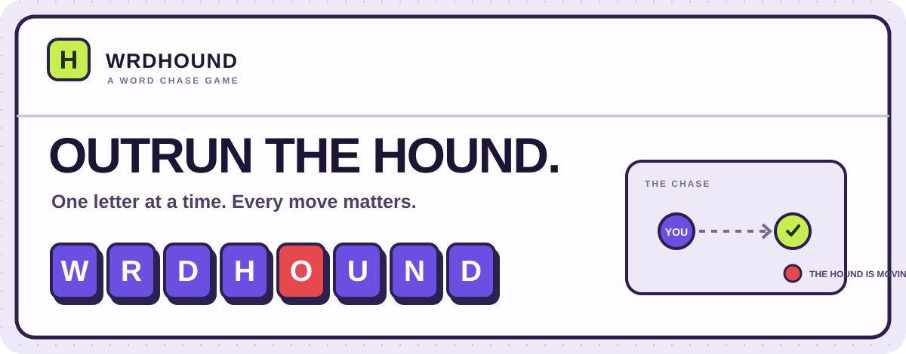
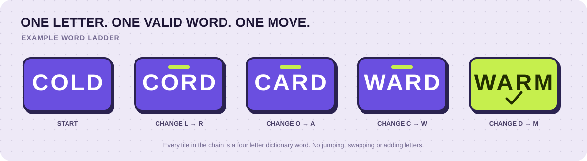
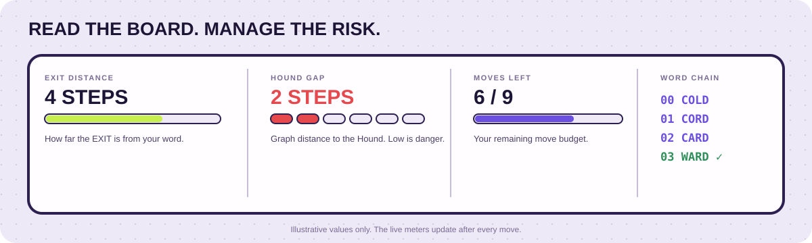
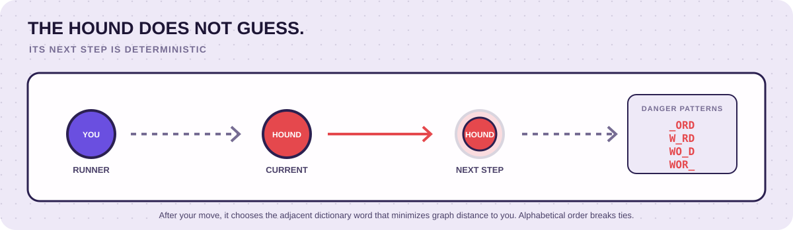

<!--
  WRDHOUND README
  Visual language mirrors the game UI:
  lavender canvas, dotted field, ink outlines, purple word tiles,
  lime objective tiles, red Hound markers, compact mono labels.
-->

<p align="center">
  
</p>

<p align="center">
  <strong>A tactical word ladder with a deterministic pursuer.</strong><br>
  Build a valid chain to the EXIT before the Hound closes the gap.
</p>

<p align="center">
  <a href="#how-to-play">HOW TO PLAY</a> ·
  <a href="#rules">RULES</a> ·
  <a href="#the-hound">THE HOUND</a> ·
  <a href="#scoring-and-hints">SCORING</a> ·
  <a href="#difficulty-and-progression">PROGRESSION</a> ·
  <a href="#install-the-pwa">INSTALL THE APP</a>
</p>

---

## The objective

You control the purple word. The lime word is your destination. The red word is the Hound.

Reach the EXIT by changing **exactly one letter per move**. Every word you enter must exist in the game's four letter dictionary. The Hound moves after every non winning move and steadily hunts your current position.

This is not simply a shortest word ladder. You must find a route that is both **linguistically valid** and **safe from pursuit**.

## At a glance

| | |
|---|---|
| **Genre** | Word strategy, pathfinding, pursuit puzzle |
| **Word length** | Four letters |
| **Dictionary** | 3,889 unique four letter words |
| **Connected play space** | 3,676 words in the largest connected component |
| **Starting score** | 25 points per puzzle |
| **Opponent** | Deterministic Hound AI |
| **Game modes** | Progressive campaign and shareable challenge links |
| **Platform** | Browser, mobile browser and installable PWA |
| **Dependencies** | No framework, no build step, no game server |

---

## How to play

<p align="center">
  
</p>

1. **Read the board.** Find your starting word, the EXIT word and the Hound's starting word.
2. **Plan a word chain.** Think of a sequence of real four letter words that connects your word to the EXIT.
3. **Change one letter.** Type the next word into the move field. It must differ from your current word in exactly one position.
4. **Submit the move.** If the word is valid and safe, you move there.
5. **Watch the Hound.** It takes its turn and moves closer according to its pursuit rule.
6. **Reach the EXIT.** Land on the EXIT before the Hound corners you or your move budget runs out.

### What counts as a legal move?

A move must satisfy all of these conditions:

- It contains exactly **four alphabetic letters**.
- It exists in the built in dictionary.
- It differs from your current word in **exactly one character**.
- It is not the Hound's current word.
- It is not a word one letter away from the Hound, unless that word is the EXIT.

The EXIT is a winning move. Reaching it ends the puzzle immediately, before the Hound takes another turn.

### What does not count?

- Changing two or more letters at once.
- Adding or removing a letter.
- Repeating the current word.
- Entering a word that is not in the dictionary.
- Moving onto the Hound or into its immediate one move reach.

---

## Understand the board

<p align="center">
  
</p>

| Indicator | What it tells you |
|---|---|
| **YOU** | Your current word, shown in purple tiles. |
| **EXIT** | The target word, shown in lime tiles. |
| **HOUND** | The pursuer's current word, shown in red tiles. |
| **SCORE** | Your remaining points for the current puzzle. |
| **MOVES** | How many moves you have made. |
| **EXIT DISTANCE** | The shortest dictionary graph distance from your current word to the EXIT. |
| **HOUND GAP** | The shortest dictionary graph distance between you and the Hound. A small gap means immediate danger. |
| **MOVES LEFT** | How many player moves remain before the move limit ends the puzzle. |
| **WORD CHAIN** | A chronological record of your moves and the Hound's responses. |

### The four danger patterns

Under the Hound's word, the game displays four patterns. Each pattern replaces one character with an underscore.

For example, if the Hound is on `WORD`, its patterns are:

| Pattern | Means |
|---|---|
| `_ORD` | Any dictionary word with O, R and D in positions 2, 3 and 4 |
| `W_RD` | Any dictionary word with W, R and D in positions 1, 3 and 4 |
| `WO_D` | Any dictionary word with W, O and D in positions 1, 2 and 4 |
| `WOR_` | Any dictionary word with W, O and R in positions 1, 2 and 3 |

A dictionary word matching one of these patterns is one move away from the Hound. Do not enter it. The live input also warns you when a typed word is inside the Hound's reach.

---

## The Hound

<p align="center">
  
</p>

The Hound uses a fixed pursuit rule. It is not a random opponent and it does not choose moves based on hidden difficulty settings.

After each non winning player move:

1. The game looks at every dictionary word one letter away from the Hound's current word.
2. It measures each candidate's shortest path distance to your new word.
3. It moves to the candidate with the **smallest distance**.
4. If multiple candidates have the same distance, it chooses the **alphabetically first word**.

This makes the chase deterministic. Given the same board state and player move, the Hound always makes the same response.

### How you get caught

You lose when either condition happens:

- **Cornered:** after the Hound moves, none of your available one letter changes is safe.
- **Out of time:** you reach the puzzle's move limit without reaching the EXIT.

The Hound's current word and every word one edge away from it are dangerous. The EXIT is the exception because reaching it wins immediately.

### Strategy notes

- Keep an eye on the Hound gap, not only the EXIT distance.
- A word that looks closer to the EXIT may put you directly inside the Hound's reach.
- Think one full turn ahead: your move changes the Hound's next position.
- Avoid routes that leave you with only one possible next word.
- The shortest ordinary word ladder is not always the safest winning route.

---

## Scoring and hints

Each new puzzle starts with **25 points**.

| Action | Score effect |
|---|---:|
| Make a player move | −1 point |
| Use the first hint | −5 hint points, plus −1 for the move it plays |
| Use the second hint | −6 hint points, plus −1 for the move it plays |
| Use the third hint | −7 hint points, plus −1 for the move it plays |
| Complete a new campaign level | A new puzzle starts with 25 points |

The score cannot fall below zero.

### How hints work

The hint button does more than reveal a suggestion. It:

1. Runs the chase solver from the current runner and Hound positions.
2. Finds a winning route that avoids the Hound.
3. Plays the next word in that route automatically.
4. Deducts the hint charge and the normal one point move charge.

The hint charge increases by one each time you use a hint in the same puzzle. The confirmation dialog shows the total cost and your remaining score before you commit.

**Use hints as a tactical resource.** They preserve a winning route when you are stuck, but reduce your final score.

---

## Difficulty and progression

The campaign generates a new puzzle when you escape. The level increases, and the target word is selected from a wider graph distance band as the campaign advances.

The target distance band is selected in two level steps:

| Campaign levels | EXIT graph distance at generation |
|---|---:|
| 0 to 1 | 3 to 5 |
| 2 to 3 | 4 to 6 |
| 4 to 5 | 5 to 7 |
| 6 to 7 | 6 to 8 |
| 8 to 9 | 6 to 9 |
| 10 onward | 6 to 10 |

The Hound begins between three and five graph steps from the player. The puzzle generator checks that a winning route exists and records its shortest safe route length as **par**.

### Your move budget

The number of moves available is calculated from the puzzle's par:

`move budget = par + max(2, 5 − floor(level / 3))`

The extra allowance tightens every three levels, down to a minimum of two moves above par. You therefore have less room for detours as the campaign progresses.

### What is par?

**Par** is the number of player moves in the shortest route found by the game solver that reaches the EXIT without being caught by the Hound. It is not simply the shortest path through the dictionary, because the Hound's position and deterministic responses matter.

---

## Game modes and sharing

### Campaign

- Start at level 0 with 25 points.
- Win to advance to the next generated puzzle.
- Retry a failed puzzle or start a fresh campaign.
- Your current campaign state is saved in the browser.

### Shareable challenge

Use the challenge share action to send someone the same starting puzzle. The link encodes the starting runner word, Hound word and EXIT word.

A challenge link has this structure:

`?c=RUNNER.HOUND.EXIT`

Opening a valid challenge link reconstructs that puzzle. Challenge play starts independently and does not overwrite your saved campaign.

### Share your result

After a successful escape, share the level, number of moves, par and score. The game uses the device's native share sheet when available. If native sharing is unavailable, it copies the result and challenge link to the clipboard.

---

## First time guide

The first visit opens a three step field guide:

1. **Reach the EXIT. Stay ahead.** Learn the one letter rule and the objective.
2. **Watch the Hound's reach.** Learn the four danger patterns and the Hound gap.
3. **Plan, then make your move.** Learn the distance indicators, move budget, hints and autosave.

The guide is shown once per browser profile. Completing or skipping it marks it as seen. It remains available at any time through the **?** button in the game header.

---

## Saving, themes and accessibility

- **Automatic save:** campaign state is stored locally in browser storage after moves and game state changes.
- **Resume:** reload the page to continue the saved campaign.
- **Theme:** switch between light and dark themes. Your choice is saved locally.
- **Motion:** tile flips, route updates and interface transitions add feedback. Reduced motion preferences are respected.
- **Keyboard:** use a physical keyboard or reveal the optional on screen QWERTY keyboard. The on screen keyboard is shown by default on coarse pointer devices, can be toggled, and remembers your preference locally. Both input methods use the same word validation and danger feedback. Dialogs support Escape and contained keyboard focus.
- **Mobile layout:** the board and controls adapt to narrow screens, safe areas and shorter viewports.
- **No account required:** game progress is stored on the device, not in a remote player account.

Clearing the browser's site data can remove your saved campaign and theme preference. Challenge links can still recreate their encoded puzzle.

---

## Install the PWA

WRDHOUND is a Progressive Web App. Once deployed over HTTPS, supported browsers can install it as a standalone app.

### Android and desktop

1. Open the published WRDHOUND website in Chrome, Edge or another supported browser.
2. Open the browser's install option. It may appear in the address bar or browser menu.
3. Confirm **Install** or **Add to desktop**.
4. Launch WRDHOUND from your home screen, app launcher or desktop.

### iPhone and iPad

1. Open the website in **Safari**.
2. Tap **Share**.
3. Choose **Add to Home Screen**.
4. Confirm the name and tap **Add**.

iOS uses the Safari Add to Home Screen flow rather than Chromium's install prompt.

### Offline support

The web app manifest defines the application name, icons, start URL, scope and standalone display mode. The service worker caches the game shell, dictionary, styles and icons after a successful online load.

- The first visit needs an internet connection to download the app files.
- After the service worker has installed and cached the app shell, the game can reopen offline.
- A newly published version updates its service worker cache when the browser activates the new worker.

---

## Run locally

The game is static and has no package installation or build step. A local HTTP server is required for service worker behavior.

```bash
git clone https://github.com/Kaelith69/WRDHound.git
cd WRDHound
python -m http.server 8000
```

Open [http://localhost:8000](http://localhost:8000) in a modern browser.

You can also use any static server that serves the repository root. Service workers require **HTTPS or localhost**.

---

## Project structure

| File | Purpose |
|---|---|
| `index.html` | Main browser entry point |
| `hound.html` | Game document |
| `hound.css` | Layout, visual theme, responsive rules and animations |
| `hound.js` | Game state, graph construction, puzzle generation, Hound AI, solver, scoring, save and share logic |
| `dictionary.js` | Four letter word list |
| `manifest.webmanifest` | PWA metadata and install icons |
| `sw.js` | Offline app shell and runtime asset cache |
| `icon-180.png`, `icon-192.png`, `icon-512.png` | App icons |
| `tests/core.test.cjs` | Graph, puzzle generation, solver and UI smoke regression tests |
| `readme-*.svg` | Custom README illustrations using the game's visual system |

### How the engine works

The game turns the dictionary into an undirected graph:

- Every dictionary word is a node.
- Two words share an edge when exactly one character differs.
- A pattern index groups words that share three of their four letters.
- Breadth first search calculates shortest word distances.
- The Hound uses those distances to choose its next step.
- A breadth first search over runner and Hound state pairs finds a safe winning route.

The graph and distance table are built locally in the browser. There is no server side gameplay service.

---

## Tests

The repository includes automated checks for the graph, solver, puzzle generation and UI smoke behavior.

Run them with Node.js:

```bash
node --check hound.js
node --check sw.js
node tests/core.test.cjs
```

The GitHub Actions workflow runs these checks and validates the PWA manifest and required app assets before attempting deployment.

---

## Publish with GitHub Pages

The repository includes a GitHub Actions workflow at `.github/workflows/pages.yml`.

**One time setup is required:**

1. Open [WRDHOUND Pages settings](https://github.com/Kaelith69/WRDHound/settings/pages).
2. Find **Build and deployment**.
3. Set **Source** to **GitHub Actions**.
4. Save the setting.

After this is configured, every push to `main` runs the validation workflow and deploys the static app when the checks pass.

**Expected website address after Pages is enabled:**

[https://kaelith69.github.io/WRDHound/](https://kaelith69.github.io/WRDHound/)

---

## Design system

The documentation illustrations are drawn to match the game rather than use unrelated stock artwork.

| Token | Light theme | Used for |
|---|---|---|
| Canvas | `#eee9f7` | Lavender dotted page background |
| Paper | `#fffdff` | Panels and cards |
| Ink | `#1d1535` | Main text and outlines |
| Purple | `#6a4fe0` | Player tiles and primary game state |
| Lime | `#c6ef4e` | EXIT, primary actions and positive emphasis |
| Red | `#e5484d` | Hound and danger states |
| Muted | `#766c93` | Labels and secondary information |

The dark theme uses a deep plum canvas, brighter purple player tiles, the same lime objective accent and a brighter red Hound.

---

<p align="center">
  <strong>Think ahead. Change one letter. Don't get cornered.</strong><br>
  <sub>WRDHOUND · A word chase game by <a href="https://github.com/Kaelith69">Kaelith69</a></sub>
</p>
